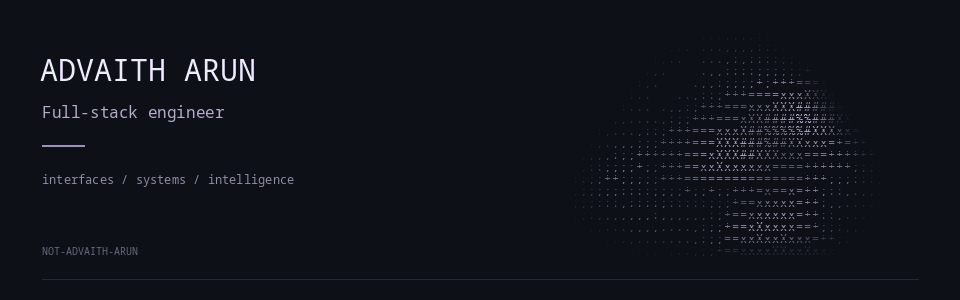

<picture>
  <source media="(prefers-reduced-motion: reduce)" srcset="assets/ascii-banner.png">
  
</picture>

- **Languages** · TypeScript, Python, Go, JavaScript, Java, C++, Rust, Swift, Kotlin
- **Frontend** · React, SolidJS, Redux, Zustand, MUI, Tailwind CSS, Framer Motion, React Flow
- **Backend** · Spring Boot, FastAPI, Node.js, Express, gRPC, WebSockets, SSE
- **Data** · PostgreSQL, MongoDB, SQLite, Redis, Firebase, Convex
- **Infrastructure** · Kubernetes, Docker, NATS JetStream, Kafka, Vault, Git
- **AI / NLP** · LLM orchestration, NER, GLiNER, RDF/SPARQL, vector search, FalkorDB, Weaviate, PyTorch
- **Mobile / Desktop** · iOS, Wear OS, BLE, Tauri
- **Auth** · RBAC, tenant isolation, Descope

[LinkedIn](https://www.linkedin.com/in/not-advaith-arun/) · [Research — Elsevier](https://doi.org/10.1016/j.rineng.2025.106220) · [Research — IEEE](https://doi.org/10.1109/ICCSP64183.2025.11089451)
