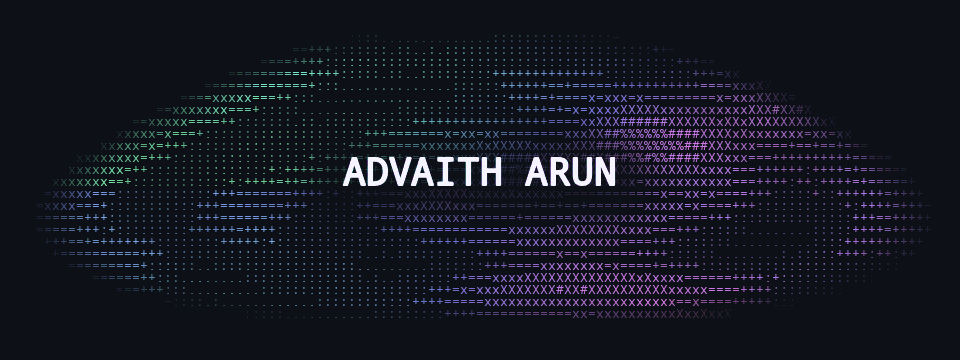

<picture>
  <source media="(prefers-reduced-motion: reduce)" srcset="assets/ascii-ripple-v2.png">
  
</picture>

- **Languages** · TypeScript / JavaScript, Python, Go, Java, C++, Rust, Swift, Kotlin
- **Web** · React, SolidJS, Redux / Zustand, Tailwind / MUI, React Flow
- **Backend** · Spring Boot, FastAPI, Node.js / Express, gRPC, WebSockets
- **Data & Cloud** · PostgreSQL, MongoDB, SQLite, Redis, Firebase, Docker, Kubernetes, NATS / Kafka
- **AI & NLP** · LLMs, PyTorch, NER / GLiNER, RDF / SPARQL, graph & vector search
- **Apps** · iOS, Wear OS, BLE, Tauri

[LinkedIn](https://www.linkedin.com/in/not-advaith-arun/) · [Research — Elsevier](https://doi.org/10.1016/j.rineng.2025.106220) · [Research — IEEE](https://doi.org/10.1109/ICCSP64183.2025.11089451)
