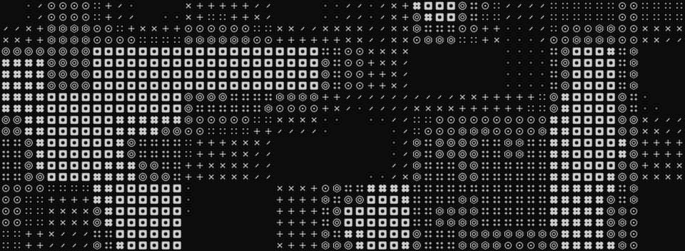

<picture>
  <source media="(prefers-reduced-motion: reduce)" srcset="assets/mono-noise-v3.png">
  
</picture>

Hardstuck c1 in Rocket League LF tutor willing to give kidney as payment

  <a href="https://xy1o.xyz">xy1o.xyz</a> &nbsp;·&nbsp;
  <a href="mailto:arunadvaith25@gmail.com">Email</a> &nbsp;·&nbsp;
  <a href="https://www.linkedin.com/in/not-advaith-arun/">LinkedIn</a>

[Elsevier — A High Performance Approach to Ensure Image Security During Transmission](https://doi.org/10.1016/j.rineng.2025.106220) 
[IEEE — Ensemble Learning Framework for Phishing URL Detection and Leveraging LLMs for Explainability](https://doi.org/10.1109/ICCSP64183.2025.11089451)
